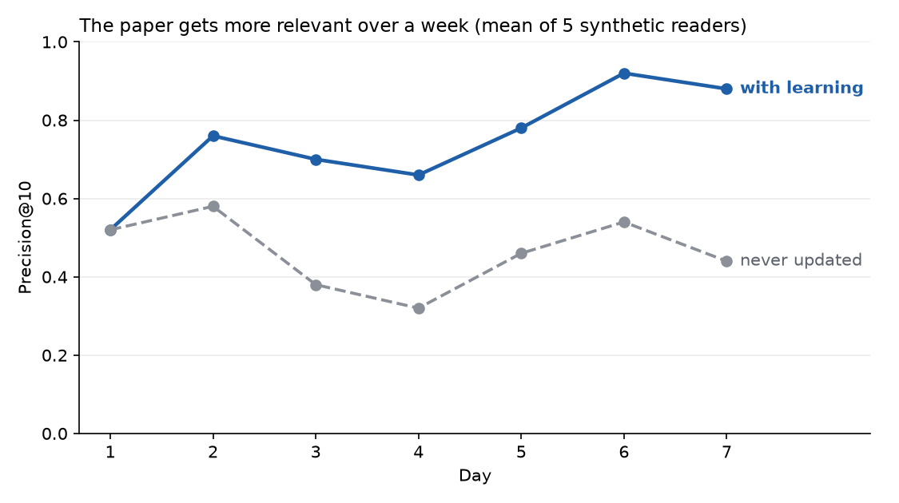

# NewsHelper

[](https://github.com/Abdul-Rafe8311/new-_helper/actions/workflows/ci.yml)

A personalised morning newspaper that gathers the day's stories, writes one edition for each reader, and learns from what they read.

## Try the demo

**<https://new-helper-nine.vercel.app>**

The demo account is seeded (`make seed` creates it), so the demo needs no sign-up. The API also has a one-click demo login at `POST /auth/demo`.

<!-- TODO: add a screenshot of /today (docs/screenshots/today.png). Only the /interests screenshots exist so far. -->
> TODO: screenshot of `/today` is not in the repo yet.

Sample edition as a PDF: [docs/samples/newshelper-sample-edition.pdf](docs/samples/newshelper-sample-edition.pdf)

## How it meets the brief

| Requirement | Feature in the repo |
| --- | --- |
| 1. Onboarding that captures interests | `/onboarding` is a step flow: name, beats (topics), free-text words parsed by Claude into keywords, reading time and depth, and a taste test on real articles. Answers autosave. |
| 2. Daily PDF in newspaper style, personalised in content and presentation | The daily pipeline composes one edition per reader and typesets it with WeasyPrint. Content is chosen from the reader's profile. Presentation follows it too: section order follows topic weights, and the reading depth (brief, balanced, deep) changes summary length and the number of briefs. |
| 3. Web reader, PDF download and archive | `/today` and `/paper/[date]` show the edition, `/archive` lists past editions, `/saved` keeps saved stories, and each edition has a PDF download. |
| 4. Learning from behaviour | Opens, reading time, saves, skips, "more like this" and "less like this" are logged as events. The `learn` stage turns them into profile changes. `/interests` shows what was learned and lets the reader edit it. |
| 5. Creative extras | Recall quiz with a streak counter and a "Still remember?" card on `/today`. Audio ("Listen"): Not yet built. "Ask your paper": Not yet built. Sunday edition: Not yet built. |

## How it learns

Each reader action becomes a small, logged change to their interest profile, with older signals fading over time. The next edition is ranked against the updated profile, and `/interests` shows every change.



Precision@10 rose from 0.52 on day 1 to 0.88 on day 7, on simulated readers (5 synthetic readers, with a control group). Details are in [docs/learning.md](docs/learning.md).

## Architecture

<!-- TODO: docs/architecture.md is not in the repo, so the Mermaid diagram is not included yet. Paste it in from docs/architecture.md once that file is added. -->
> TODO: the architecture diagram (`docs/architecture.md`) is not in the repo yet.

For now, the flow in short: the daily pipeline runs `ingest -> enrich -> learn -> compose -> render` against Postgres, the API serves editions and PDFs, and the web app talks to the API through a `/api/*` rewrite. See [docs/composer.md](docs/composer.md), [docs/ingestion.md](docs/ingestion.md) and [docs/decisions/0001-stack.md](docs/decisions/0001-stack.md).

## Stack

| Layer | Technology |
| --- | --- |
| API | FastAPI, Python 3.12, SQLAlchemy 2 (async), Alembic, uv |
| Database | Postgres with pgvector, hosted on Supabase |
| Web | Next.js, TypeScript, Tailwind, pnpm |
| PDF | Jinja2 and WeasyPrint |
| AI | Anthropic Claude API (Haiku for bulk work, Sonnet for the daily editor call); embeddings with fastembed `BAAI/bge-small-en-v1.5`, run in the pipeline only |
| Files | Supabase Storage in production, local disk in dev |
| Hosting | API on Render (Docker image), web on Vercel |
| CI/CD | GitHub Actions |

## Local setup

```bash
git clone https://github.com/Abdul-Rafe8311/new-_helper.git && cd new-_helper
cp .env.example .env   # then set DATABASE_URL (Supabase session pooler), JWT_SECRET, CRON_SECRET
make install
make migrate
make seed
make dev               # API on :8000, web on :3000
```

You need Python 3.12, [uv](https://docs.astral.sh/uv/), Node.js and pnpm. There is no local Docker database: point `DATABASE_URL` at a Supabase project. Run `make test` and `make lint` before you commit. On macOS, PDF rendering needs `brew install pango` and `DYLD_FALLBACK_LIBRARY_PATH=/opt/homebrew/lib`.

## Environment variables

Names and purpose only. Copy `.env.example` to `.env`; never commit it.

| Name | Purpose |
| --- | --- |
| `ENV`, `LOG_LEVEL`, `GIT_SHA` | Runtime mode, log level, and the commit shown by `/health` |
| `CORS_ORIGINS`, `WEB_URL` | Allowed browser origins and the public web URL |
| `DATABASE_URL` | Postgres connection (Supabase pooler, asyncpg driver) |
| `STORAGE_BACKEND`, `STORAGE_LOCAL_DIR` | `local` or `supabase` file storage, and the local folder |
| `SUPABASE_URL`, `SUPABASE_SERVICE_KEY`, `SUPABASE_BUCKET` | Supabase Storage in production |
| `PDF_PAGE_SIZE` | A4 or Letter |
| `JWT_SECRET`, `JWT_EXPIRY_DAYS` | Session token signing and lifetime |
| `CRON_SECRET` | Shared secret for `/internal` routes |
| `DEMO_EMAIL` | Email of the seeded demo account |
| `ANTHROPIC_API_KEY` | Claude API access |
| `LLM_FAST_MODEL`, `LLM_SMART_MODEL` | Models for bulk work and the daily editor call |
| `LLM_DAILY_BUDGET_USD` | Daily LLM spend cap; above it summaries fall back to extractive |
| `EMBEDDING_MODEL`, `EMBEDDING_DIM`, `FASTEMBED_CACHE_DIR` | Local embedding model, vector size and cache folder |
| `ALLOWED_LANGUAGES` | Languages kept at ingestion |
| `REDDIT_ENABLED` | Turns the Reddit fetcher on or off |
| `APIFY_TOKEN`, `APIFY_GNEWS_ACTOR`, `APIFY_EXTRACT_ACTOR` | Optional Apify fallback scrapers |
| `ELEVENLABS_API_KEY` | Optional key reserved for the audio edition (not built yet) |
| `API_URL` | Where the web app rewrites `/api/*` to |
| `QUIZ_ENABLED` | Web flag that shows or hides the quiz |
| `RENDER_DEPLOY_HOOK_URL`, `VERCEL_TOKEN`, `VERCEL_ORG_ID`, `VERCEL_PROJECT_ID` | GitHub Actions secrets for deploys |

## CI/CD

Every pull request runs `CI` (API, Docker and web jobs, filtered by changed paths and gated by one `CI OK` check), `CodeQL`, and a Conventional Commits check on the PR title. `main` is protected, and changes land through a PR merged with a merge commit. After CI passes on `main`, the `Deploy` workflow builds the API image, runs migrations, deploys to Render, deploys the web app to Vercel, and runs a smoke test. Pull requests that touch the web app get a Vercel preview. A scheduled `Daily pipeline` workflow runs the pipeline stages every day. See [docs/deployment.md](docs/deployment.md).

[](https://github.com/Abdul-Rafe8311/new-_helper/actions/workflows/ci.yml)

## Cost per edition

Not measured yet. The composer records LLM calls and cost on each edition's stats, but no figures are stored in the repo. It makes one smart-model call per reader per day ([docs/composer.md](docs/composer.md)), and `LLM_DAILY_BUDGET_USD` caps daily spend.

## Known limits

- Photo downloads and Supabase storage were verified in production only for the PDF path.
- The quiz explanations need a newly composed edition. Older editions show the right answer without an explanation.
- Audio ("Listen"), "Ask your paper" and the Sunday edition are not built yet.
- The learning result comes from simulated readers, not real ones. The weights are untuned against real reading.

## Roadmap

Future work, not built yet:

- Audio briefing of the edition.
- "Ask your paper": questions answered from the day's edition.
- A Sunday edition.
